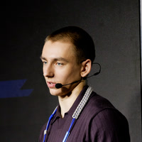

# Александр Гольдебаев

Разрабатывает распределённые системы на C#/.NET в «Золотом Яблоке». Учится на программе «Компьютерные технологии» в ИТМО.

## Контакты и проекты

- Написать Александру в Telegram — [@bornToWhine](https://t.me/bornToWhine).
- Канал о разработке и о людях, которые пишут код, — [Type-Safe Thoughts](https://t.me/ts_thoughts).
- Записаться на менторскую встречу — [GetMentor](https://getmentor.dev/mentor/aleksandr-goldebaev-7864) или [Solvery](https://solvery.io/ru/mentor/30993).
- Послушать подкаст о технических книгах — [BookClub DotNet](https://bookclubdotnet.mave.digital/).
- Присоединиться к встрече клуба разговорного английского для айтишников в Петербурге — [Let’s Speak IT!](https://t.me/piter_lets_speak).
- Репозитории с примерами из докладов — [GitHub](https://github.com/Alexanderbtw).

## Доклады

**Async переезжает в Runtime**

[E-CODE 2026](https://ecode.ozon.tech/talks/20010690/) · [Стачка 2026](https://spb.nastachku.ru/lp/spb26/speeches/async-pereezzhaet-v-runtime) · [Бенчмарки Runtime Async](https://github.com/Alexanderbtw/async-runtime)

**Roslyn as a Service**

[Запись SpbDotNet №117](https://www.youtube.com/watch?v=nWuP-H2d9-s) · [Программа ITS BMSTU × StepOne](https://t.me/steponeit/824)

Примеры из доклада — [компилятор](https://github.com/Alexanderbtw/compiler), [дампер промежуточных представлений](https://github.com/Alexanderbtw/rolsyn-pipeline-dumper) и [стенд с анализаторами и генератором кода](https://github.com/Alexanderbtw/roslyn-stand).

**.NET Aspire in Action / Aspire in Action**

[Запись SpbDotNet №95](https://www.youtube.com/watch?v=9xe8FelZf34) · [Запись DotNext 2024](https://www.youtube.com/watch?v=hZ-yQNlwblQ) · [Запись SpbDotNet №103](https://www.youtube.com/watch?v=oSvkj74gU-8) · [Стачка 2025](https://spb25.nastachku.ru/lp/proekt-1/speeches/net-aspire-in-action)

[Демостенд из доклада на SpbDotNet №103](https://github.com/Alexanderbtw/AspireStarterStand)

**OpenTelemetry для самых маленьких**

[Запись SpbDotNet №99](https://www.youtube.com/watch?v=X3faF3xw3m8) · [Демостенд с телеметрией](https://github.com/Alexanderbtw/TelemetryExample)

## Дискуссии

- На «Стачке» в 2026 году вместе с Глебом Цыгановым и Артёмом Рыченковым разбирал, можно ли доверить LLM запросы к базе данных. [Круглый стол о генерации SQL](https://spb.nastachku.ru/lp/spb26/speeches/llm-baza-dannykh-mozhno-li-razreshit-mashine-samoi-pisat-sql)
- Приглашённый эксперт на четырёх сессиях DotNext 2026. [Шардирование баз данных](https://dotnext.ru/talks/20010643-how-to-shard-your-database-so-as-not-to-regret-it-later/) · [Агенты в SDLC](https://dotnext.ru/talks/20010432-how-to-use-agents-across-the-entire-sdlc/) · [Native AOT и JIT](https://dotnext.ru/talks/20010408-native-aot-vs-jit-in-net-10-performance-optimizations-and-pitfalls/) · [Контроль над разработкой с ИИ](https://dotnext.ru/talks/20010540-ai-is-confident-i-m-not-how-not-to-lose-control-over-development/)
